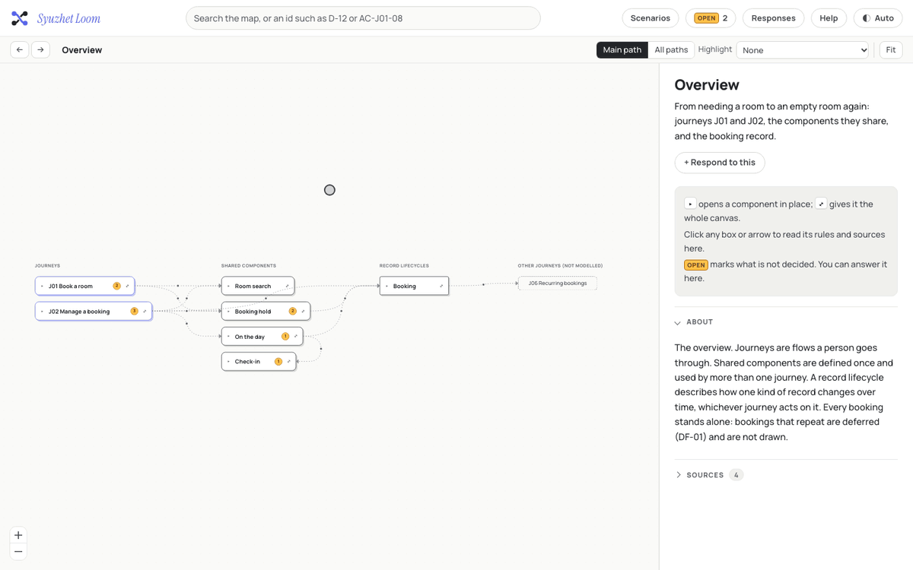
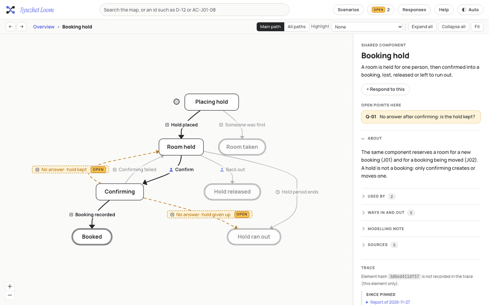
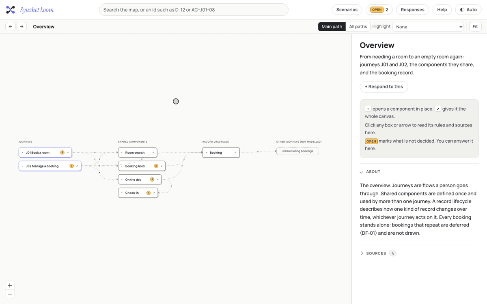

# Syuzhet Loom

*Structure precedes execution.*

**Behavioural modelling and traceability infrastructure for agentic software engineering.**

Syuzhet Loom writes down what a product does as typed, hierarchical state machines, keeps every state and transition tied to the decision or acceptance criterion it came from, and records how the model relates to the other layers of the work (handoffs, designs, code, tests) at exact revisions. Where the specification has not decided something, the model says **OPEN** instead of guessing.



*The viewer running the bundled example (meeting-room booking). All media in this README is captured from the live viewer with `scripts/record-demo.mjs`; see [docs/media](docs/media/README.md).*

> **Status: v0.1.0, early.** The model schema, validator, viewer, trace, and staleness report work and are tested on the bundled example. Syuzhet Loom is not yet an installable package: you adopt it by cloning this repository and replacing the example model. **Not implemented in this release:** agent orchestration, Linear and Figma integrations, ingestion of CI results as evidence, and formal verification. Autonomous agent orchestration and formal verification are [roadmap](ROADMAP.md) objectives; today Syuzhet Loom launches no agent, calls no external service and proves nothing.

## The problem

When agents write most of the code, the scarce thing is no longer code. It is an exact, shared statement of what the product is supposed to do, and a way to tell when something has drifted from it.

A prompt-driven workflow keeps that statement in prose: a ticket, a spec page, a chat thread. Each agent re-reads the prose and fills the gaps with plausible guesses. Three things go wrong:

- **Guesses look like decisions.** An agent that meets an undecided branch picks an answer, and the choice is then buried in a design or a diff.
- **Layers drift apart silently.** The spec changes, and the handoff, the design and the tests that were made from the old version still look finished.
- **Status gets inferred.** A closed ticket is read as "accepted", a test that exists is read as "passing", a design that exists is read as "the behaviour is confirmed".

## How Syuzhet Loom differs

| Prompt-driven agentic coding | With Syuzhet Loom |
|---|---|
| Behaviour is prose that each agent interprets | Behaviour is typed data: states are conditions, transitions are events, each with who causes it, its guard and its effects |
| Gaps are filled by the model that happens to be writing | A gap is an **OPEN** mark tied to a tracked question, with the documented alternatives drawn. The validator rejects an open mark with no question |
| "Per the spec" | Every element cites ids (`D-12`, `AC-J01-08`) and the viewer shows the original wording behind each one |
| Context is whatever was pasted | A reference names its revision (`handoff:room-booking/v1#IX-05`, `code:repo@sha:path#L10-L20`). Model elements carry a content hash |
| A change upstream is noticed by luck | The staleness report compares every pinned reference with what exists now and lists what needs review |
| Done means the agent stopped | A definition is not a run and a link is not an approval. Statuses are quoted from the record that holds them, never computed |

Syuzhet Loom does not replace the specification, the tracker or the design tool. It sits between them as the layer everything else can point at.

## Quickstart

Needs Node.js 20 or newer and git. No account, credentials or network access after installation.

```bash
git clone https://github.com/aaroneponymous/syuzhet-loom.git
cd syuzhet-loom
npm ci
npm test            # validates the example model and trace, runs the self-tests, type-checks
npm run dev         # viewer at http://localhost:5173
```

Then, in the viewer: click **▸** on *J01 Book a room* to expand it in place, **⤢** on *Booking hold* to focus it, click a state to read its rules and sources, and scroll the panel to **Trace**.

To see the staleness report find something real (the example's handoff v2 changes two rows the trace pinned at v1):

```bash
npm run trace-staleness     # writes trace-reports/STALENESS.md and staleness.json
```

For a static build: `npm run build && npm run preview` (http://localhost:4173).

The example is self-contained: the model in `src/model/`, its invented source documents and handoffs in `workspace/`, and its trace in `trace/example.json`. Nothing in it describes a real product.

## What a model looks like

```ts
export const j01: MachineDef = machine({
  id: 'j01',
  title: 'J01 Book a room',
  kind: 'journey',
  summary: 'Say what is needed, pick a room, confirm while it is held.',
  entries: { default: 'searching' },
  states: [
    initial(),
    s('searching', 'Finding a room', { uses: 'room-search', refs: ['D-04'] }),
    s('reserving', 'Reserving the room', { uses: 'booking-hold', refs: ['D-06', 'D-10'] }),
    final('booked', 'Room booked', { refs: ['D-10', 'AC-J01-12'] }),
    final('left', 'Left without booking', { refs: ['D-05', 'D-11'] }),
  ],
  transitions: [
    t('searching', 'reserving', 'Room picked', { fromExit: 'chosen', actor: 'user', flow: 'main', refs: ['D-06', 'AC-J01-04'] }),
    t('reserving', 'searching', 'Hold ran out', {
      fromExit: 'expired', toEntry: 'results', actor: 'time', flow: 'side', refs: ['D-08', 'AC-J01-08'],
      interpretation: 'That the person lands on the list of rooms, rather than on an empty search, is assumed from D-09.',
    }),
    // …
  ],
});
```

(Abridged from `src/model/machines/booking.ts`.) A state that `uses` another machine is a composite with named entries and exits, so a connection means the same thing whether the composite is drawn open or closed. Independent dimensions are regions of a `parallel` machine that interact only through signals. `interpretation` marks structure the modeller added that the sources do not state. The rules are in [MODELING.md](MODELING.md).

## Traceability



The trace is a sidecar file. It points at model elements and at records in other layers, and changes none of them.

- **Pinned references.** A `v1` reference resolves only against `v1/`, whatever later versions exist. Model endpoints carry an element hash (SHA-256 of the element's canonical JSON) alongside a baseline commit.
- **Links with a stated basis**: `stated`, `derived` or `interpretation`. Both ends must exist.
- **Coverage gaps without invented endpoints**: "checked, none found" (naming what was checked, at which revision) is different from "nobody has traced this" and from "out of scope".
- **Quoted statuses.** The validator checks that each quote still appears in the file that holds it.
- **Definitions apart from runs.** A scenario or a test existing is not a result. Only a recorded check run carries a pass or fail. The example has no runs, and the viewer says so.
- **Findings and draft work items.** A discrepancy is logged against the elements it concerns, with issue text ready to copy. Nothing is sent anywhere.
- **Staleness.** `npm run trace-staleness` reports, separately, whether each pin still matches what was recorded, whether a later version changed the item, and which links, findings and records rest on something that changed.

Concepts: [docs/TRACE.md](docs/TRACE.md).

## Architecture

```
 source documents ──extract-sources──▶ sources.json ─┐
 (workspace/spec)                                    │
                                                     │
 src/model  (types, dsl, machines, questions, ───────┼──▶ validate ──▶ well formed?
             scenarios)                              ├──▶ coverage ──▶ COVERAGE.md
                    │                                └──▶ viewer (React Flow) ◀── response log (local)
                    │ element hashes
                    ▼
 trace/*.json  (refs, revisions, links, gaps,  ──validate:trace──▶ resolves at the pinned commit?
                statuses, definitions, runs,   ──trace-staleness─▶ what needs review
                findings, work items)
                    │ points into
                    ▼
 workspace/handoffs/<slice>/vN, design/vN ; other git repositories (code:, test:)
```

| Part | Where | What it is |
|---|---|---|
| Model | `src/model/` | Plain typed data: schema (`types.ts`), a small DSL (`dsl.ts`), machines, open questions, scenarios. No rendering code |
| Source wording | `workspace/spec/` → `src/model/generated/sources.json` | The text behind every cited id, extracted with file hashes |
| Validator and coverage | `scripts/validate.ts`, `scripts/coverage.ts` | Structural checks; where each acceptance criterion is represented |
| Viewer | `src/viewer/` | React, React Flow and dagre. Renders whatever the model contains; static build; no network requests |
| Response log | `responses-plugin.ts` | Answers and comments typed in the viewer are written to a local file for review. A response is input, not a decision |
| Trace | `src/trace/`, `trace/` | Types, reference parsing, hashing, queries; the data file |
| Trace checks | `scripts/validate-trace.ts`, `scripts/trace-staleness.ts` | Validation against the pinned commit; the staleness report |
| Configuration | `loom.config.ts` | Where the workspace, handoffs, source documents and other repositories are. `LOOM_WORKSPACE` overrides it |

More, including what each check does and does not establish: [docs/ARCHITECTURE.md](docs/ARCHITECTURE.md).

## The workflow Syuzhet Loom is built for

Syuzhet Loom was built for, and used on, a private product, in three connected flows. There, the agents were started and reviewed by a person; nothing was orchestrated autonomously. The table says what this repository gives you for each flow and what you still do yourself.

| Flow | In this release | Not in this release |
|---|---|---|
| **1. Requirements → behaviour model.** A tracker issue references a model element; the element leads to its decisions, open points and trace | The model, source extraction, coverage, the viewer with deep links to any machine, state, transition or open point, findings and draft work-item text | Any tracker integration. Issues are created and linked by hand (Linear: roadmap) |
| **2. Behaviour model → design.** A designer or design agent receives a versioned handoff whose rows name model elements, and returns a design map | The handoff and design-map layout the trace reads (`workspace/handoffs/`), pinned `handoff:` and `design-map:` references, the `figma:` reference scheme, staleness when a handoff version changes | Agent definitions, agent invocation and any orchestration; reading Figma (roadmap) |
| **3. Model and design → implementation and verification.** Code and tests cite model element ids; runs are recorded against revisions | `code:` and `test:` references resolved at their commit, test definitions kept apart from check runs, implementation and verification layers in the viewer | Ingesting CI results as runs; test generation (roadmap) |

The private product's model, designs and recordings are not part of this repository.



## Integrations

| | Status |
|---|---|
| git | **Implemented.** The trace pins commits; validation loads the model as it was at the pinned commit; `code:` and `test:` references resolve in local repositories |
| Linear | **Not in this release.** Work items are drafts with copyable text and a de-duplication key |
| Figma | **Reference scheme only.** `figma:` references are validated against the design map that lists them. Figma itself is never contacted |
| Notion | **Reference scheme only.** `notion:` references are counted as external and not checked |
| CI | A GitHub Actions workflow runs `npm test` and `npm run build`. Ingesting test results into the trace is not implemented |

## What the checks establish

| Kind | What exists | What it shows |
|---|---|---|
| Structural validation | `npm run validate`, `npm run validate:trace` | The model and trace are well formed and their references resolve at the pinned revisions. Not that the model is right |
| Automated tests | `npm run test:trace` (53 checks), `npm run test:staleness` (62 checks) | The validators reject each kind of invalid record; hashes are stable; the staleness report behaves as specified on fixtures |
| Type checking | `tsc --noEmit` | The model and tools type-check |
| Runtime check | `scripts/browser-check.mjs` (optional, not in `npm test`) | The built viewer loads the example, renders the trace, logs no console errors and makes no external request |
| Formal verification | **None** | No model checking, no proofs, no simulation. See the roadmap |

Passing checks show that the artifacts are well formed and consistent with each other. They do not show that the behaviour is correct.

## Limitations

- **Template, not a package.** The model lives in this repository's `src/model/`. There is no CLI and no npm package yet.
- **One example.** The tools have been exercised on the bundled example and on one private product model (32 modelled machines: 3 journeys, 21 shared components and 8 record lifecycles, with about 220 states). That model is not public, so this cannot be checked from this repository.
- **Trace validation needs git, `sh` and `tar`**, so it does not run on plain Windows (WSL works).
- **The model is TypeScript that is executed when loaded.** Only validate models you trust. See [SECURITY.md](SECURITY.md).
- **Scenarios are checked for existence, not executed.**
- **The handoff file layout is fixed** (`<slice>/vN/SCREEN_SPEC.md` and so on).
- **The dev and preview servers are for localhost.** They have no authentication, and the response log writes files on the machine that runs them.
- **No sign-in, no editing of the model in the viewer, no collaboration, no synchronisation with any service.**

## Contributing

Issues and pull requests are welcome; start with [CONTRIBUTING.md](CONTRIBUTING.md). Useful first contributions:

- Package the tools as a CLI that reads a model from another repository.
- Make trace validation work on Windows (replace the `git archive | tar` loader).
- A JSON form of the model and a JSON Schema for it.
- A second example in a different domain.
- A findings drawer and a "has trace gap" highlight in the viewer.

## Roadmap

[ROADMAP.md](ROADMAP.md): packaging and a CLI; agent role and workflow definitions with a dry-run context assembler; Linear and Figma integrations; evidence ingestion from CI; simulation, model-based testing and export to a model checker.

## The name

*Syuzhet* is a term from Russian Formalist literary theory for the deliberate arrangement of a story's underlying events into the structure in which they are presented. A loom weaves separate threads into one fabric; here the threads are requirements, behavioural specifications, design artifacts, implementation and verification evidence. Together the name says that software behaviour should be explicitly structured, connected and traceable.

## Licence

[Apache License 2.0](LICENSE). Copyright 2026 Aaron Paul. See [NOTICE](NOTICE).

The bundled fonts (Manrope, Instrument Serif) are under the SIL Open Font License 1.1; their licence texts are in `src/viewer/assets/fonts/`.
